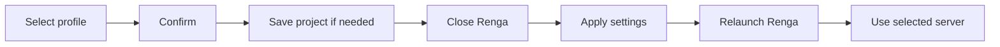

<div align="center">


# Renga Server Switcher

**Server profile manager for Renga Professional Collaboration Server**

Save your connection settings once. Quickly switch servers, work offline, and relaunch Renga without manually re-entering credentials.

<p>
  
  
  
  
</p>
<p>
  
  
  
  
</p>

**[📦 Releases](../../releases)** · **[📖 User guide](docs/USER_GUIDE.md)** · **[🛠 Installation](docs/INSTALL.md)** · **[🇷🇺 Русский](README.md)**

<sub>v1.1.2 · Author: <b>kartashov_ma</b> · Tested with Renga Professional 9.3.32980.0 / Windows x64</sub>

</div>

---

## 🚀 Why use it?

Changing a Collaboration Server in Renga normally requires manually editing the host, port, user name and access key in **Settings → Collaboration**, followed by restarting the application.

**Renga Server Switcher** stores these settings as named profiles and lets you activate another profile in a few steps, including a prompt to save unsaved project changes before the restart.

## ✨ Features

| | Feature | Description |
|:--:|---|---|
| 🗂️ | **Server profiles** | Store a name, IP/DNS, port, user name and access key |
| 🔄 | **Automatic relaunch** | Apply connection settings after Renga exits and restart it |
| 📴 | **Offline working mode** | Work without connecting to a saved collaboration server |
| 🟢 | **Active profile** | See connection status and highlighted active profile |
| 📡 | **Server reachability test** | Test TCP access to the host and port |
| ⚙️ | **Per-profile synchronization** | Store automatic change synchronization separately |
| 🔐 | **DPAPI encryption** | Encrypt access keys in the plugin's profile store |
| 💾 | **Project safety** | Prompt to save unsaved project changes |
| 🧰 | **Profile management** | Add, edit, delete and detect duplicates |
| 📝 | **Preferences and logs** | Optional window auto-show and diagnostics |

## 🔁 Switching workflow



| Scenario | Action |
|---|---|
| Server A → Server B | Select profile B and click **Connect** |
| Server → Offline | Click **Work locally** |
| Offline → Server | Select a saved profile and confirm |

## 📦 Install

1. Download the compiled ZIP from [Releases](../../releases), if a binary release is available.
2. Completely close Renga.
3. Extract the compiled plugin files to:

   ```text
   C:\Program Files\Renga Professional\Plugins\RengaServerSwitcher\
   ```

4. Start Renga, enable the module under **Plug-ins** if needed and open its toolbar button.

> GitHub-generated `Source code (zip)` contains **source files, not a compiled plugin**. Use the separate binary ZIP in **Release assets** for installation.

## 🛠 Build from source

Tested configuration: **Renga Professional 9.3.32980.0**, **Renga API 2.50**, **Windows x64**, **.NET 8**, **Visual Studio 2022**. You need official Renga SDK 9.3 libraries locally; SDK binaries are intentionally excluded from the source repository. Build the solution in **Release / x64**.

See [DEVELOPMENT](docs/DEVELOPMENT.md) and [INSTALL](docs/INSTALL.md).

## 🔐 Security and limitations

> [!IMPORTANT]
> DPAPI encryption protects **only the plugin's stored server profiles**. Renga itself can write the active server access key into `settings.ini` and a backup. Do not share those files.

> [!NOTE]
> A successful TCP reachability test does not verify credentials or authorization.

> [!WARNING]
> Offline working mode uses an unreachable loopback endpoint, not an official Renga Offline API. Compatibility with versions other than the tested build has not been validated.

## 📚 Documentation

| Document | Purpose |
|---|---|
| [USER_GUIDE](docs/USER_GUIDE.md) | Working with profiles and offline mode (Russian) |
| [INSTALL](docs/INSTALL.md) | Installation and build instructions |
| [ARCHITECTURE](docs/ARCHITECTURE.md) | Components and restart workflow |
| [DEVELOPMENT](docs/DEVELOPMENT.md) | SDK setup, build and packaging |
| [COMPATIBILITY](docs/COMPATIBILITY.md) | Tested versions |
| [TROUBLESHOOTING](docs/TROUBLESHOOTING.md) | Problem diagnosis |
| [SECURITY](SECURITY.md) | Sensitive information and vulnerability reports |
| [CHANGELOG](CHANGELOG.md) | Version history |

## 📌 Status & author

**Version:** `1.1.2` · **Status:** Stable on tested configuration · **Author:** `kartashov_ma` · **Year:** 2026.

Copyright © 2026 `kartashov_ma`. **All rights reserved.** See [LICENSE](LICENSE) and [THIRD_PARTY_NOTICES](THIRD_PARTY_NOTICES.md).

---

<div align="center">
  <strong>Renga Server Switcher</strong><br />
  <sub>Less manual configuration. Faster switching. Safer project handoff.</sub><br /><br />
  <a href="README.md">Русский</a> · <a href="../../releases">Releases</a>
</div>
