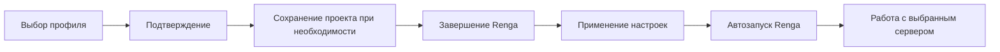

<div align="center">


# Renga Server Switcher

**Быстрое переключение серверов совместной работы в Renga Professional**

Сохраните параметры подключения один раз — выбирайте сервер из списка, переключайтесь в автономный режим и продолжайте работу без ручного изменения настроек.

<p>
  
  
  
  
</p>
<p>
  
  
  
  
</p>

**[📦 Скачать готовую сборку — Releases](../../releases)** · **[📖 Инструкция](docs/USER_GUIDE.md)** · **[🛠 Установка](docs/INSTALL.md)** · **[🇬🇧 English](README.en.md)**

<sub>Версия 1.1.2 · Автор: <b>kartashov_ma</b> · Проверено на Renga Professional 9.3.32980.0 / Windows x64</sub>

</div>

---

## 🚀 Зачем нужен модуль

В стандартной Renga смена сервера совместной работы требует вручную открывать **Настройки → Совместная работа**, менять адрес, порт, имя пользователя и ключ доступа, а затем перезапускать приложение.

**Renga Server Switcher** сохраняет эти параметры в отдельных профилях. Чтобы сменить сервер, достаточно выбрать профиль, подтвердить действие и при необходимости сохранить проект — после этого Renga автоматически перезапустится с нужной конфигурацией.

> **Главное преимущество:** вместо повторного ввода настроек — переключение между готовыми серверными профилями, включая режим автономной работы.

## ✨ Возможности

| | Функция | Что делает |
|:--:|---|---|
| 🗂️ | **Профили серверов** | Название, IP/DNS, порт, пользователь и ключ доступа для каждого подключения |
| 🔄 | **Автоматический перезапуск** | Применяет профиль после завершения Renga и запускает приложение повторно |
| 📴 | **Автономный режим** | Позволяет работать без подключения к сохранённому серверу |
| 🟢 | **Активный профиль и статус** | Показывает текущее подключение и выделяет используемый профиль |
| 📡 | **Проверка доступности** | Проверяет TCP-соединение с сервером и отображает результат |
| ⚙️ | **Синхронизация по профилю** | Отдельно сохраняет параметр автоматической синхронизации изменений |
| 🔐 | **Защита ключей** | Шифрует ключи *в хранилище профилей модуля* средствами Windows DPAPI |
| 💾 | **Защита проекта** | Предлагает сохранить несохранённые изменения до переключения |
| 🧰 | **Удобный интерфейс** | Добавление, редактирование, удаление и защита от дублирования профилей |
| 📝 | **Журнал и настройки** | Автопоказ окна, история операций и диагностика ошибок |

## 🔁 Как происходит переключение



**Три основных сценария:**

| Сценарий | Действие |
|---|---|
| **Сервер A → сервер B** | Выберите профиль B и нажмите **«Подключиться»** |
| **Сервер → автономная работа** | Нажмите **«Остаться работать локально»** |
| **Автономная работа → сервер** | Выберите сохранённый профиль и подтвердите подключение |

Повторное подключение к уже активному профилю блокируется, чтобы не выполнять лишний перезапуск.

## 📦 Установка готового плагина

1. Откройте **[Releases](../../releases)** и скачайте ZIP готовой сборки, если она опубликована.
2. **Полностью закройте Renga**.
3. Распакуйте все файлы сборки в каталог:

   ```text
   C:\Program Files\Renga Professional\Plugins\RengaServerSwitcher\
   ```

4. Запустите Renga и проверьте модуль в разделе **Настройки → Подключаемые модули**.
5. Откройте **Renga Server Switcher** кнопкой на панели приложения или включите автопоказ его окна.

> **Не путайте:** архив `Source code (zip)`, который GitHub создаёт автоматически, содержит исходники, а не готовый плагин. Для установки нужен ZIP, добавленный автором в **Assets** релиза.

Подробнее: [инструкция по установке](docs/INSTALL.md) · [руководство пользователя](docs/USER_GUIDE.md).

## 🛠 Сборка из исходного кода

| Компонент | Требование |
|---|---|
| Renga | **Renga Professional 9.3.32980.0** — проверенная версия |
| API | **Renga API 2.50 / официальный SDK Renga 9.3** |
| ОС | **Windows x64** |
| Среда | **Visual Studio 2022**, **.NET 8 SDK** |
| Конфигурация | **Release / x64** |

Откройте `RengaServerSwitcher.sln`, подключите библиотеки официального SDK согласно [DEVELOPMENT](docs/DEVELOPMENT.md) и выполните сборку решения.

Собранные файлы находятся в `_build\RengaServerSwitcher\`. **Бинарные файлы SDK намеренно не включены в исходный репозиторий**.

## 🔐 Безопасность и важные ограничения

> [!IMPORTANT]
> **DPAPI защищает ключи в собственном хранилище профилей плагина.** При применении подключения сама Renga может записать активный ключ доступа в свой `settings.ini` и в резервную копию. Не публикуйте эти файлы и убедитесь, что профиль Windows защищён.

> [!NOTE]
> **Проверка TCP-доступности не проверяет авторизацию.** Успешное соединение с портом не означает, что ключ доступа правильный.

> [!WARNING]
> **Автономный режим** реализован с помощью недоступного локального сетевого адреса (loopback), а не отдельного официального Offline API Renga. Работа проверена на указанной сборке Renga 9.3; совместимость с другими версиями не гарантируется.

Не размещайте в публичном репозитории `profiles.json`, `settings.ini`, файлы журналов, дампы, ключи и снимки экрана с внутренними адресами серверов.

## 📚 Документация

| Руководство | Описание |
|---|---|
| [📖 USER_GUIDE](docs/USER_GUIDE.md) | Как добавить профиль, подключиться, переключиться в автономный режим |
| [📦 INSTALL](docs/INSTALL.md) | Установка готовой сборки и первый запуск |
| [🧩 ARCHITECTURE](docs/ARCHITECTURE.md) | Архитектура плагина и вспомогательного процесса |
| [🛠 DEVELOPMENT](docs/DEVELOPMENT.md) | Сборка из исходников, SDK и подготовка релиза |
| [✅ COMPATIBILITY](docs/COMPATIBILITY.md) | Поддерживаемые и непроверенные версии |
| [🩺 TROUBLESHOOTING](docs/TROUBLESHOOTING.md) | Диагностика проблем и восстановление настроек |
| [🛡 SECURITY](SECURITY.md) | Работа с ключами и сообщения об уязвимостях |
| [📝 CHANGELOG](CHANGELOG.md) | История версий |

## 🏗 Состав проекта

```text
RengaServerSwitcher/
├── src/
│   ├── RengaServerSwitcher.Plugin/         # UI, профили, Renga API
│   └── RengaServerSwitcher.RestartHelper/  # применение настроек и запуск
├── docs/                                    # инструкции и совместимость
├── scripts/                                 # подготовка SDK и релизного архива
├── .github/                                 # issue / PR templates
├── README.md / README.en.md
├── CHANGELOG.md
└── RengaServerSwitcher.sln
```

## 📌 Статус и автор

**Текущая версия:** `1.1.2` · **Статус:** стабильная для протестированной конфигурации · **Автор:** `kartashov_ma` · **Год:** 2026.

Проект проверен на **Renga Professional 9.3.32980.0**. Другие версии требуют отдельного тестирования.

**Правовой статус:** Copyright © 2026 `kartashov_ma`. **All rights reserved.** Публикация исходников не означает предоставления лицензии на изменение или распространение. См. [LICENSE](LICENSE) и [THIRD_PARTY_NOTICES](THIRD_PARTY_NOTICES.md).

---

<div align="center">
  <strong>Renga Server Switcher</strong><br />
  <sub>Быстрее переключаться. Меньше вводить вручную. Безопаснее сохранять проект.</sub><br /><br />
  <a href="README.en.md">English</a> · <a href="docs/USER_GUIDE.md">Руководство</a> · <a href="../../releases">Releases</a>
</div>
